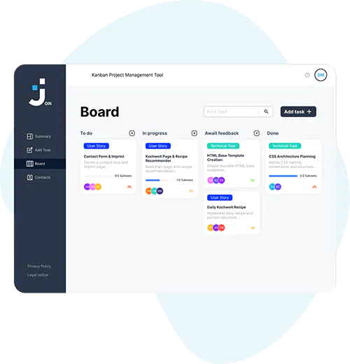

# Join

<table>
    <tr>
        <td valign="top" width="65%">
        Join is a Kanban-based project management tool designed and built by a group of
        dedicated students as part of their web development bootcamp at the Developer Akademie.
          
        Kanban, a Japanese term meaning "billboard", is an effective method to visualize work, limit
        work-in-progress, and maximize efficiency (or flow). Join leverages these principles
        to help users manage tasks and projects through an intuitive, visual interface.
          
        Join features real-time synchronization across all instances. Whenever a task's state changes, a user is added or removed,
        the update is instantly reflected everywhere.
          
        

        <h4>⚠️ Educational Disclaimer</h4>
        
<em>Please note that Join was developed as a capstone educational project and is not intended for commercial production or enterprise-grade usage. While we ensure a robust user experience, continuous uptime and data persistence cannot be guaranteed.</em>

        

        </td>
        <td align="center" valign="middle" width="35%">
        
        </td>
    </tr>
</table>

## Technologies

| Technology &nbsp;&nbsp;&nbsp;&nbsp;&nbsp;&nbsp;&nbsp;&nbsp;&nbsp;&nbsp;&nbsp;&nbsp;&nbsp;&nbsp;&nbsp; | Purpose                      |
| :---------------------------------------------------------------------------------------------------- | :--------------------------- |
| **&nbsp;&nbsp;&nbsp; Angular 22**                                | Frontend Framework           |
| **&nbsp;&nbsp;&nbsp; Supabase**                                | Backend & Real-time Database |
| **&nbsp;&nbsp;&nbsp; TypeScript**                                  | Type-Safe Application Logic  |
| **&nbsp;&nbsp;&nbsp; HTML**                                            | Structure                    |
| **&nbsp;&nbsp;&nbsp; SCSS**                                            | Styling                      |

## How to use it

<table>
        Here is a step-by-step guide on how to use Join.
    <tr>
        <td valign="top" width="65%">
          
        1. <strong>Exploring the Board</strong> 
        When you log in to Join, you'll find a default board representing your project. It contains four default lists: "To Do", "In Progress", "Await feedback", and "Done".
          
        2. <strong>Creating Contacts</strong> 
        You can add contacts to collaborate on your projects. Go to the "Contacts" section, click "New contact", and fill in the required information. Once added, these contacts can be assigned to tasks and interact with the board.
          
        3. <strong>Adding Cards</strong> 
        Now that you've added contacts, you can start adding cards representing individual tasks. Click the "+" button under the appropriate list to create a new card, then fill in details like task name, description, due date, and assignees.
          
        4. <strong>Moving Cards</strong> 
        As tasks move from one stage to another, reflect their progress on the board by dragging and dropping them between lists.
          
        5. <strong>Deleting Cards</strong> 
        Once a task is completed, you can move it to the "Done" list or delete it. Deleting a card permanently removes it from the board. Please exercise caution, as this action is irreversible.
          
        Using Join effectively requires consistent updates from you and your team to ensure the board accurately reflects your project's current state.
        </td>
    </tr>
</table>

Have more questions about Join? Feel free to contact us at svenprimus@gmail.com
We're here to help!

**Enjoy using Join!**
